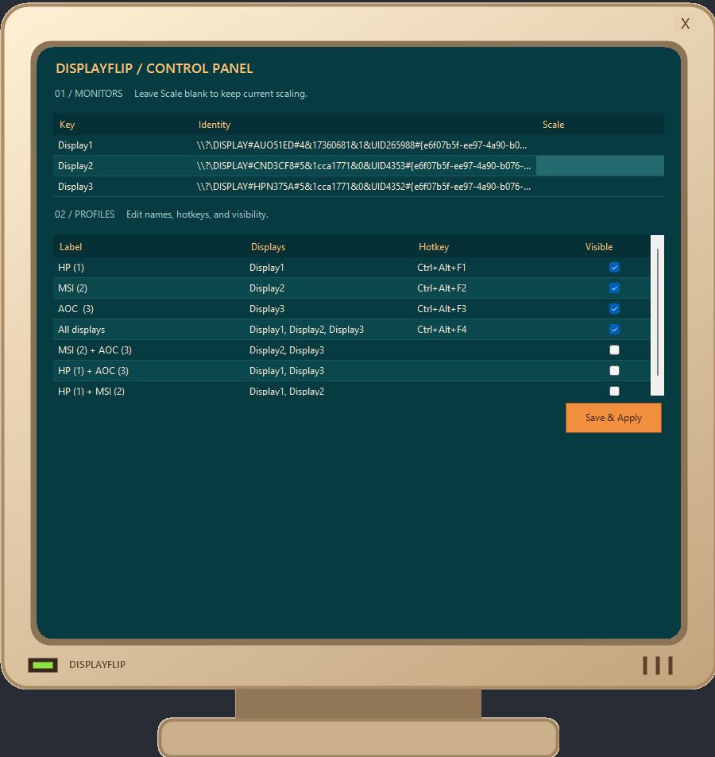

# DisplayFlip

A small Windows system tray app for switching monitor combinations with a menu or global hotkeys. Powered by the [DisplayConfig PowerShell module](https://github.com/MartinGC94/DisplayConfig).



## Requirements

For the packaged app, extract the entire ZIP to a writable folder and run **DisplayFlip.exe**. Keep the files together. DisplayConfig is bundled, and personal configuration is generated on first launch. Double-click the tray icon to open settings.

The executable is a console-free C# launcher for the PowerShell app. Windows PowerShell 5.1 is still required. Module installation below is only needed when running from source or building a package.

- Windows with Windows PowerShell 5.1 and a desktop session.
- The DisplayConfig module installed for the current user:

```powershell
Install-Module DisplayConfig -Scope CurrentUser
```

## Setup

Before setting up the app, connect and activate all displays you want to use in Windows Settings > System > Display. Keep them active when you first launch DisplayFlip so it can discover their names and create the presets.

Run `Start-DisplayFlip.cmd` and right-click the tray icon. When `Monitors.psd1` exists, the app loads it and populates the tray from those settings. Only when the file is absent does the app discover displays and save the generated settings to `Monitors.psd1`. Later launches load that file without rediscovering presets. No manual monitor configuration is required. After setup, use the presets to switch displays on and off.

Each display gets an individual preset and Ctrl+Alt+F1, F2, etc. An additional "All displays" preset gets the next hotkey. Labels include a number to distinguish identical names; unnamed panels use "Display". Full device paths identify monitors independently of their names. Numbering follows device-path order and can change when hardware or ports change. Restart after connecting new hardware. Beyond 23 displays, additional individual presets are menu-only; F24 selects all displays.

Automatic configuration leaves scaling unchanged. Run `Show-Diagnostics.cmd` to inspect detected displays. To customize presets, optionally use an edited copy of `Monitors.Example.psd1` as `Monitors.psd1`. The example preserves the original setup. Custom mode supports arbitrary labels, combinations, hotkeys, and scaling.

The tray also lists every combination of two or more displays as menu-only presets, keeping the individual-display and "All displays" hotkeys unchanged. Three displays produce seven choices: three individual displays, three pairs, and all displays. An all-off preset is never generated. For more than eight displays, only individual displays and "All displays" are generated to keep the menu manageable; define custom combinations in `Monitors.psd1` for larger setups.

Keep `DisplayFlip.ps1`, `DisplayFlip.Hotkeys.cs`, `DisplayFlip.Window.cs`, and `icon.ico` together. The launchers and `Autostart.ps1` should remain in the same folder. `icon.png` is the source artwork for the tray icon.

## Example custom presets and hotkeys

| Preset | Hotkey |
| --- | --- |
| OLED | Ctrl+Alt+F1 |
| LCD | Ctrl+Alt+F2 |
| OLED + LCD | Ctrl+Alt+F3 |
| Laptop + LCD | Ctrl+Alt+F4 |
| All displays | Ctrl+Alt+F5 |

Hotkeys work while other apps are active. Holding a hotkey does not repeat the command. If another app has registered a hotkey, DisplayFlip reports the conflict; the tray menu remains available.

Display identities are resolved again on each selection. Missing displays are skipped. If none of the requested displays are connected, the operation is blocked. Ambiguous or duplicate mappings also block the operation. Unconfigured displays are left unchanged.

Each preset enables its target displays and disables the other configured displays in one `Enable-Display` call. The menu may briefly stop responding while the command runs. There is no polling or background timer.

## Scaling

An optional `Scale` value on each monitor sets its scaling percentage at startup and after selecting a preset containing that monitor. The example configuration sets LCD to 100%. Omit `Scale` to leave scaling unchanged. Disconnected or inactive displays are skipped. Windows must support the requested scaling percentage for that display. The app does not explicitly set resolution, refresh rate, position, or the primary display.

## Configuration

In **Settings...**, each preset has a **Visible** checkbox. Clear it and click **Save & Apply** to hide the preset from the tray and disable its hotkey without deleting it. Rechecking it restores both. Existing presets are visible by default; manual configurations can set `Visible = $false` on a preset.

Choose **Settings...** in the tray to edit preset labels, hotkeys, visibility, and scaling. Click **Save & Apply** to save the file and refresh the tray and shortcuts immediately, without restarting. Leave scaling blank to preserve it. Monitor keys, identities, and preset display combinations are read-only in this window. Invalid settings are rejected; unavailable hotkeys are reported and those presets remain accessible from the tray. Each save preserves the previous file in a uniquely named `.bak` file. Generated files include commented editing instructions. The tray checks the active combination whenever you open the menu, considering configured monitors only.

Personal `Monitors.psd1` files are ignored by Git and excluded from source archives. The copy already tracked in this repository must still be untracked before publishing the repository itself; ignore rules do not untrack existing files. Distribute `Monitors.Example.psd1` instead.

Edit `Monitors.psd1` in a text editor to customize your setup. In `Monitors`, change monitor identities and optional `Scale` percentages. In `Presets`, change `Label` for the tray text, `Names` for the monitors to enable, and `Hotkey` for the shortcut. Keep the monitor keys and preset `Names` consistent. For manual file edits, restart DisplayFlip to load them. Use the settings window to save and apply changes immediately.

You can use `Monitors.Example.psd1` as a starting point. The settings saved on first launch can be edited in the same way. The application folder must be writable to save the file.

An existing `Monitors.psd1` is authoritative: it must contain valid Monitors and Presets tables. Empty or invalid files report an error instead of triggering discovery. Move the file out of the application folder to use automatic discovery. Restart DisplayFlip after editing it.

```powershell
@{
    Monitors = @{
        Desk = @{ Identity = 'DISPLAY#YOUR_MODEL#'; Scale = 100 }
        Laptop = @{ Identity = 'DISPLAY#YOUR_PANEL#' }
    }
    Presets = @(
        @{ Label = 'Desk only'; Names = @('Desk'); Hotkey = 'Ctrl+Alt+F1' },
        @{ Label = 'Both'; Names = @('Desk', 'Laptop'); Hotkey = 'Ctrl+Alt+F2' }
    )
}
```

Monitor names are arbitrary keys shared by `Monitors` and preset `Names`. Preset order determines menu order. Each preset needs a label and at least one configured monitor. The app rejects unknown monitor names, repeated names, and duplicate hotkeys.

`Hotkey` is optional; omit it or use an empty string for a menu-only preset. Supported keys are A-Z and F1-F24 with optional Ctrl, Alt, Shift, and Win modifiers, for example `Ctrl+Shift+F8` or `Ctrl+Alt+M`. Modifier order and capitalization do not matter.

`Scale` must be an integer from 100 to 500; actual supported percentages depend on the monitor and Windows. The five presets in Monitors.Example.psd1 preserve the original setup. There is no built-in limit of three monitors or five presets.

## Start with Windows

Toggle **Open at startup** in the tray to enable or disable launching DisplayFlip at sign-in for your account. The checkmark shows whether the startup shortcut exists. Changes take effect immediately without restarting the app. You can also use `Enable-Autostart.cmd` and `Disable-Autostart.cmd`. Administrator access is not required. Disabled shortcuts are preserved under `%LOCALAPPDATA%\DisplayFlip\DisabledStartup`.

The startup shortcut points to the current application folder. If you move the folder, enable autostart again to update it.

Packaged copies use `DisplayFlip.exe` for startup; source copies use PowerShell.

## Build the executable

Run `powershell.exe -NoProfile -ExecutionPolicy Bypass -File .\Build-DisplayFlip.ps1`. The build uses the Windows .NET Framework compiler and the installed DisplayConfig module. Each build creates a new folder and ZIP under `dist`, excluding personal settings and backups. There is no automatic release workflow yet.

### Upgrading from MonitorTray

Exit MonitorTray and disable its autostart before launching DisplayFlip. If you already renamed the files, move the old `MonitorTray.lnk` out of your Windows Startup folder (`shell:startup`) to a backup folder. Then run `Enable-Autostart.cmd` to create the new `DisplayFlip.lnk` shortcut.
